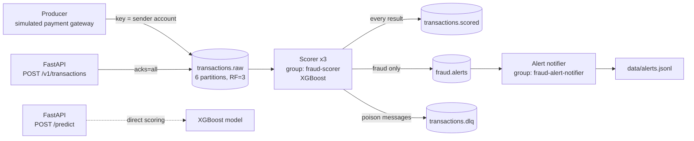

# Real-Time Fraud Detection Pipeline

An event-driven fraud-detection system. An XGBoost model scores payment transactions as they stream through a fault-tolerant **Apache Kafka** cluster. Suspected fraud is routed to an alerts topic, and bad messages are isolated in a dead-letter queue. A **FastAPI** gateway lets you score a single transaction or publish one into the stream.

The whole stack runs locally with one `docker compose up`.

> **Status:** ongoing personal project. Planned next steps are listed in the [Roadmap](#roadmap).

---

## Architecture



All four Python services (`api`, `producer`, `scorer`, `alerts`) are built from **one Docker image** and share code in `app/common/`.

---

## Key features

### Reliable Kafka cluster
- **3-broker cluster in KRaft mode** (no ZooKeeper). Each node is both broker and controller.
- **Replication factor 3, `min.insync.replicas=2`**, and unclean leader election disabled. A broker can fail without losing acknowledged messages (try it with `./scripts/demo.sh broker-down`).
- **Idempotent producer with `acks=all`**, so retries never create duplicates.
- Topics are created explicitly with fixed partitions and retention. Auto-creation is turned off.

### Ordering and scaling
- Messages are **keyed by sender account** (`nameOrig`, murmur2 partitioner), so each account's transactions stay in order on one partition.
- **6 partitions** let the scorer consumer group scale horizontally (`--scale scorer=6`), using **cooperative-sticky rebalancing** so only the partitions that move are paused.
- A **separate alert consumer group** reads `fraud.alerts` independently (publish/subscribe).

### Processing guarantees
- **Exactly-once scoring with Kafka transactions.** Output messages and input offsets are committed together (`send_offsets_to_transaction`), and downstream consumers use `read_committed`. If a batch fails, the transaction is aborted and the batch is re-read.
- An **at-least-once mode** is available as a fallback (`PROCESSING_GUARANTEE=at_least_once`).
- The alert notifier is at-least-once and **de-duplicates by `transaction_id`** (idempotent consumer).
- **Dead-letter queue.** Invalid JSON or schema violations go to `transactions.dlq` with the error and source partition/offset, instead of blocking the partition.

### Data contracts and serving
- **Versioned Pydantic schemas** (`schema_version`) with field validation, plus Kafka headers carrying schema version, content type and producer name.
- **Shared feature engineering** for training-style features: log amount, balance deltas, time of day, sender/receiver frequency maps, merchant flag, and one-hot transaction type.
- **Fixed a training–serving skew bug.** The old code used `pd.get_dummies(..., drop_first=True)` on a single row, which dropped the transaction type entirely. The fix and its regression test are in `features.py` and `tests/test_features_serde.py`.

---

## Kafka topics

| Topic | Partitions | Retention | Contents |
| --- | --- | --- | --- |
| `transactions.raw` | 6 | 7 days | Incoming transactions, keyed by sender account |
| `transactions.scored` | 6 | 7 days | Every transaction with its fraud probability and label |
| `fraud.alerts` | 3 | 30 days | Transactions flagged as fraud |
| `transactions.dlq` | 3 | 14 days | Messages that could not be processed, with error details |

All topics use replication factor 3 and `min.insync.replicas=2` (see `scripts/create_topics.sh`).

---

## Quick start

### Prerequisites
- Docker and Docker Compose
- The trained model artifacts in `app/model/` (not committed to Git, see note below):
  - `fraud_xgb_model.pkl`
  - `model_features.pkl`
  - `frequency_maps.pkl`

> **Note:** model files are git-ignored to keep the repository small. Moving them to a model registry (MLflow) is on the [Roadmap](#roadmap).

### Run

```bash
docker compose up -d --build
```

| Service | URL |
| --- | --- |
| FastAPI docs (Swagger) | http://localhost:8000/docs |
| Kafka UI | http://localhost:8080 |

Stop everything with `docker compose down` (add `-v` to delete Kafka data).

---

## API

### `POST /predict`: score one transaction directly

```bash
curl -X POST http://localhost:8000/predict \
  -H "Content-Type: application/json" \
  -d '{
        "step": 10, "type": "TRANSFER", "amount": 181000,
        "nameOrig": "C1305486145", "oldbalanceOrg": 181000, "newbalanceOrig": 0,
        "nameDest": "C553264065", "oldbalanceDest": 0, "newbalanceDest": 0
      }'
```

Returns `transaction_id`, `fraud_probability` and `is_fraud`.

### `POST /v1/transactions`: publish into the Kafka stream

The same request body returns **202 Accepted** once the in-sync replicas have acknowledged the message. The response includes the topic, key, partition and offset. The transaction is then scored by the consumer group.

| Error | Meaning |
| --- | --- |
| 503 | Producer unavailable or its queue is full |
| 504 | Timed out waiting for the Kafka acknowledgement |
| 502 | Kafka delivery failed |

### `GET /health`
Reports whether Kafka is reachable and how many brokers are visible.

---

## Demo script

`scripts/demo.sh` walks through the Kafka features step by step:

```bash
./scripts/demo.sh topics        # partitions, leaders, replicas, ISR
./scripts/demo.sh groups        # which scorer owns which partition, and lag
./scripts/demo.sh scale 6       # add consumers and watch the rebalance
./scripts/demo.sh broker-down   # stop one broker; writes keep working
./scripts/demo.sh broker-up     # broker rejoins and catches up
./scripts/demo.sh dlq           # send a poison message and see it in the DLQ
./scripts/demo.sh api           # publish through the API
./scripts/demo.sh lag           # consumer lag
```

---

## Configuration

Every service reads the same environment variables (`app/common/config.py`), so the system can be configured from Docker Compose or Kubernetes without code changes. The main ones:

| Variable | Default | Purpose |
| --- | --- | --- |
| `KAFKA_BOOTSTRAP_SERVERS` | `kafka-1:29092,kafka-2:29092,kafka-3:29092` | Brokers to connect to |
| `PROCESSING_GUARANTEE` | `exactly_once` | `exactly_once` or `at_least_once` |
| `FRAUD_THRESHOLD` | `0.5` | Probability above which a transaction is flagged |
| `SCORER_BATCH_SIZE` | `200` | Messages per scoring batch |
| `MODEL_VERSION` | `xgb-v1` | Version tag added to scored messages |
| `PRODUCER_TPS` | `5` | Simulated transactions per second |
| `PRODUCER_FRAUD_RATIO` | `0.10` | Share of simulated transactions that look fraudulent |
| `PRODUCER_NUM_CUSTOMERS` | `500` | Size of the simulated customer pool |
| `GROUP_INSTANCE_ID` | *(empty)* | Optional static membership to avoid rebalances on restart |

---

## Tests

```bash
pip install -r requirements-dev.txt
pytest
```

16 unit tests cover:
- the transactional commit path, abort and batch rewind, and fatal errors;
- at-least-once commit ordering;
- dead-letter contents, serialization and schema validation;
- feature engineering, including the one-hot regression test.

Kafka is replaced with fakes (`tests/fakes.py`), so no broker is needed. One test that loads the real model is skipped if the model files are missing.

---

## Project structure

```
app/
├── api.py              # FastAPI: /predict, /v1/transactions, /health
├── producer.py         # simulated payment gateway
├── consumer.py         # scoring consumer group (exactly-once, DLQ)
├── alert_consumer.py   # alert notifier (idempotent, at-least-once)
└── common/
    ├── config.py       # environment-based settings
    ├── features.py     # feature engineering shared by API and scorer
    ├── kafka_clients.py # producer/consumer configuration
    ├── model.py        # XGBoost model loading and scoring
    ├── schemas.py      # versioned Pydantic message contracts
    ├── serde.py        # serialization and Kafka headers
    └── logging_setup.py
scripts/
├── create_topics.sh    # topic creation (partitions, RF, retention)
└── demo.sh             # step-by-step feature demo
tests/                  # unit tests with Kafka fakes
docker-compose.yml      # 3-broker KRaft cluster + Kafka UI + app services
Dockerfile              # one non-root image for all services
```

---

## Roadmap

Planned extensions, not yet implemented:

- [ ] **Online feature store.** Feast with Redis for streaming per-account velocity features (for example, transaction count and amount over the last hour).
- [ ] **Model registry.** MLflow for versioned models, replacing the git-ignored `.pkl` files and letting the scorer load a model by version.
- [ ] **Kubernetes deployment.** Run Kafka with the Strimzi operator and the services as Deployments, with stable consumer identities for static membership.
- [ ] **Monitoring.** Prometheus and Grafana for throughput, consumer lag and latency, and Evidently for data and prediction drift.

---

## Tech stack

Python 3.11 · Apache Kafka 3.x (Confluent Platform 7.6, KRaft) · confluent-kafka · XGBoost · pandas · FastAPI · Pydantic v2 · Docker Compose · pytest

